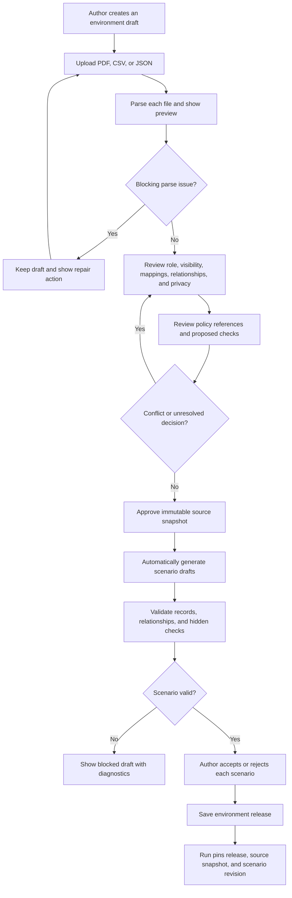

# Week 1 developer handoff: files and organization knowledge

Status: ALK implementation complete; platform integration and release gates pending

Last updated: 2026-11-12

Owner: Agent Learning Kit and Future AGI Simulation teams

## 1. Purpose

This document is the source of truth for the Week 1 implementation of "Use files and organization knowledge."

The feature lets an environment author upload policies and records, review exactly how those files will be used, approve a versioned source snapshot, and automatically receive draft scenarios based on that snapshot. The tested agent can use approved reference material. It cannot modify imported records or see evaluator-only material.

This plan starts from the current `alk-dev` codebase. It has no dependency on PR 206 or the branch named `codex/pr206-isolate-model-code`.

## 2. Definition of done

The feature is done only when all of these statements are true in the cloud product and the ALK library:

1. An author can upload PDF policies and CSV or JSON records while creating an environment without first creating an agent.
2. Every file has an independently visible parsing state, preview, role, visibility, source hash, and blocking diagnostics.
3. The author can review proposed field mappings, relationships, synthetic replacements, policy references, and executable rule proposals before approval.
4. Approval creates an immutable source snapshot. A changed file, mapping, privacy choice, visibility choice, parser revision, or rule decision creates a different snapshot.
5. Agent-visible policies are searchable reference material. Agent-visible records are read-only reference data.
6. Evaluator-only content cannot appear in tested-agent input, simulated-actor input, tools, environment state, artifacts, events, logs, reports, manifests available to those participants, or model prompts for those participants.
7. Approved executable rules use only registered structured checks. Source text never becomes arbitrary code or a dynamically created tool.
8. Snapshot approval automatically starts draft scenario generation. Generated scenarios remain inactive until the author accepts them.
9. Generated scenario packs include successful behavior, refusal behavior when applicable, and an intentionally wrong negative control.
10. A run is linked to the exact source snapshot, source revisions, scenario revision, and evaluator check revision used for that run.
11. A missing record, broken relationship, unresolved policy conflict, unsupported rule, or missing verification evidence cannot be reported as complete coverage.
12. The acceptance tests in section 18 pass against the real cloud flow and the ALK integration.

## 3. Resolved product decisions

These decisions are final for Week 1.

| Topic | Decision |
| --- | --- |
| Accepted files | PDF, CSV, and JSON only |
| Policy input | PDF |
| Record input | CSV or JSON |
| Imported records | Read-only reference data |
| Policy behavior | Searchable reference plus proposed executable rules |
| Rule activation | Explicit author approval is required |
| Scenario generation | Starts automatically after source snapshot approval |
| Scenario activation | Generated scenarios are drafts until accepted |
| Personal data | Synthetic replacement is the default |
| Hidden material | Evaluator-only is a first-class visibility mode |
| Knowledge bases and connectors | Not included in Week 1 |
| Refresh behavior | Re-upload creates a new source revision and snapshot |

## 4. Week 1 boundary

### Included

- Direct upload during environment design.
- PDF text extraction with page provenance.
- CSV and JSON record parsing with row provenance.
- Field mapping, stable identifiers, and cross-file relationships.
- Explicit privacy and visibility review.
- Type-aware synthetic replacement for supported structured fields.
- Policy statement extraction and rule proposals.
- Immutable reviewed source snapshots.
- Read-only compilation into existing ALK environment adapters.
- A separate evaluator-only payload.
- Automatic draft scenario generation.
- Run-to-snapshot provenance.

### Not included

- Organization knowledge base connectors.
- Google Drive, Notion, SharePoint, or scheduled synchronization.
- OCR for scanned PDFs.
- DOCX, XLSX, TSV, JSONL, TXT, or Markdown.
- Record mutation, generated write tools, or a mutable database world.
- Automatic policy enforcement without review.
- Arbitrary expressions, Python, SQL, or source-provided code in evaluator checks.
- Automatic activation of generated scenarios.
- In-place refresh of a snapshot used by an earlier run.

## 5. User flow



Uploading a file does not change a released environment. Approval creates a source snapshot. Accepting scenarios and saving the environment creates a release. These are separate actions.

## 6. State model

Use one explicit state field. Do not implement the lifecycle as several booleans.

```text
uploaded
  -> parsing
  -> needs_review
  -> approved
  -> generating_scenarios
  -> scenario_review
  -> ready
```

Failure states are `parse_blocked`, `review_blocked`, and `generation_failed`.

- `parse_blocked` preserves the upload and all successful file previews.
- `review_blocked` preserves the draft and the author's completed decisions.
- `generation_failed` preserves the approved source snapshot and supports an idempotent retry.
- Any source change after approval creates a new draft. It never edits the approved snapshot.
- Regeneration creates a new scenario draft set. It never overwrites an accepted scenario set.

## 7. Domain model

The public API belongs in `fi.alk.studio` because Studio already owns authoring, import, content scanning, scenario generation, and approval-oriented workflows.

The implementation must use immutable Pydantic models or frozen dataclasses with immutable collection fields. Freezing only the outer object is insufficient.

### 7.1 Core enums

```python
SourceRole = Literal["policy", "seed_records"]
SourceVisibility = Literal["agent_visible", "evaluator_only"]
PersonalDataMode = Literal["none", "synthetic_replace"]
SourceState = Literal[
    "uploaded",
    "parsing",
    "needs_review",
    "parse_blocked",
    "review_blocked",
    "approved",
    "generating_scenarios",
    "generation_failed",
    "scenario_review",
    "ready",
]
RuleDecision = Literal["accepted", "rejected", "reference_only"]
```

Role and visibility are separate. A policy or record source can be agent-visible or evaluator-only.

### 7.2 Input and provenance types

```python
class EnvironmentSource:
    source_id: str
    filename: str
    media_type: str
    content: bytes
    role: SourceRole

class SourcePin:
    source_id: str
    source_sha256: str
    parser_revision: str
    role: SourceRole

class SourceSpan:
    source_id: str
    page: int | None
    row: int | None
    field: str | None
    start: int | None
    end: int | None

class SourceDiagnostic:
    code: str
    severity: Literal["warning", "blocking"]
    message: str
    span: SourceSpan | None
```

`source_id` is generated by the platform before ALK parsing. It is stable across retries of the same upload. `source_sha256` is computed from the original bytes. `parser_revision` changes whenever normalization can produce different output.

### 7.3 Record review types

```python
class FieldMapping:
    source_field: str
    target_field: str
    data_type: Literal["string", "integer", "number", "boolean", "date", "datetime"]
    is_stable_id: bool
    personal_data: bool

class RecordRelationship:
    from_source_id: str
    from_field: str
    to_source_id: str
    to_field: str

class RejectedRecord:
    source_id: str
    row: int
    reasons: tuple[str, ...]

class RecordReview:
    source_id: str
    visibility: SourceVisibility
    personal_data_mode: PersonalDataMode
    fields: tuple[FieldMapping, ...]
    relationships: tuple[RecordRelationship, ...]
```

The parser proposes mappings and relationships. The author confirms them. At least one stable identifier is required for each record source. Identifier values must be nonempty and unique within that source.

### 7.4 Policy review types

```python
class PolicyStatement:
    statement_id: str
    text: str
    span: SourceSpan

class PolicyRuleProposal:
    rule_id: str
    statement_id: str
    kind: Literal[
        "required_behavior",
        "forbidden_behavior",
        "refusal",
        "eligibility",
    ]
    check_type: str | None
    check_arguments: Mapping[str, JsonValue]
    status: Literal["supported", "unsupported", "conflict"]

class PolicyReview:
    source_id: str
    visibility: SourceVisibility
    decisions: Mapping[str, RuleDecision]
```

Policy statements are always preserved as cited reference text in the reviewed snapshot. A rule proposal is executable only when all of these conditions hold:

- The author selected `accepted`.
- `check_type` is registered in the ALK evaluator check registry.
- `check_arguments` pass that check type's schema.
- The scenario exposes enough evaluator evidence for the check.
- No unresolved policy conflict applies.

An unsupported rule can be kept as `reference_only` or rejected. It cannot silently become an active check.

### 7.5 Review and output types

```python
class EnvironmentInputDraft:
    sources: tuple[ParsedSource, ...]
    diagnostics: tuple[SourceDiagnostic, ...]
    draft_digest: str

class EnvironmentInputReview:
    expected_draft_digest: str
    record_reviews: tuple[RecordReview, ...]
    policy_reviews: tuple[PolicyReview, ...]

class ReviewedEnvironmentInputs:
    snapshot_id: str
    snapshot_digest: str
    reviewer_id: str
    reviewed_at: datetime
    sources: tuple[ReviewedSource, ...]

class CompiledEnvironmentInputs:
    agent_environments: tuple[Mapping[str, JsonValue], ...]
    evaluator_inputs: EvaluatorInputSet
    public_provenance: Mapping[str, JsonValue]

class GeneratedScenarioDraftSet:
    source_snapshot_id: str
    source_snapshot_digest: str
    public_scenarios: tuple[Scenario, ...]
    evaluator_specs: tuple[EvaluatorScenarioSpec, ...]
    diagnostics: tuple[ScenarioDiagnostic, ...]
```

The platform authenticates the reviewer. ALK records the supplied identity but does not authenticate it.

## 8. Public ALK API

Expose only three source lifecycle functions and one scenario generation function.

```python
from fi.alk.studio import (
    compile_environment_inputs,
    generate_source_scenarios,
    prepare_environment_inputs,
    review_environment_inputs,
)

draft = prepare_environment_inputs(
    sources,
    destination_schema=approved_environment_schema,
)

reviewed = review_environment_inputs(
    draft,
    review=author_review,
    reviewer_id=authenticated_reviewer_id,
)

compiled = compile_environment_inputs(reviewed)

scenario_drafts = generate_source_scenarios(
    reviewed,
    environment_requirements=approved_environment_requirements,
    requested_count=requested_count,
)
```

The API stages reflect real persistence and human review boundaries.

- `prepare_environment_inputs` validates bytes and returns the exact preview to display.
- `review_environment_inputs` rejects stale or incomplete decisions and creates the immutable snapshot.
- `compile_environment_inputs` creates separate agent and evaluator projections.
- `generate_source_scenarios` operates only on an approved snapshot and returns drafts.

Do not add public parser classes, storage abstractions, plugin registries, or a second simulation runner.

## 9. File parsing contract

### 9.1 Shared limits

- Maximum file size is 25 MiB.
- Maximum files per environment design is 100.
- Maximum combined uploaded size per environment design is 200 MiB.
- The platform upload boundary and ALK parsing boundary enforce the same limits.
- All files are treated as data. No macros, links, formulas, imports, or embedded code are executed.
- The existing Studio content scanner in `src/fi/alk/studio/_scan.py` is reused for stored injection and secret markers. It is not treated as a personal-data detector.

### 9.2 PDF

- PDF is accepted only for the `policy` role in Week 1.
- Add one maintained PDF text extraction dependency under an `environment-inputs` optional dependency group. Include that group in the cloud image and the project's `all` extra.
- Extract text page by page and preserve one-based page numbers and character offsets.
- Normalize line endings and Unicode consistently before hashing the draft.
- Password-protected, corrupt, empty, and image-only PDFs produce blocking diagnostics.
- OCR is out of scope.
- Never follow PDF links or extract attachments.

### 9.3 CSV

- CSV is accepted only for the `seed_records` role.
- Use the Python standard library `csv` module.
- Accept UTF-8 and UTF-8 with BOM.
- The first row is the header.
- Duplicate or empty headers are blocking.
- Rows with extra or missing cells are rejected with row-level diagnostics.
- Cell values remain strings until the reviewed field mapping converts them.
- Spreadsheet formulas remain plain strings and are never evaluated.

### 9.4 JSON

- JSON is accepted only for the `seed_records` role.
- Use the Python standard library `json` module.
- The top level must be an array of objects.
- Every object must use string keys.
- Nested objects and arrays are blocking in Week 1. The author must flatten them before upload.
- A field absent from some rows is allowed only when the destination schema marks it optional.
- Duplicate stable identifiers are blocking.

## 10. Mapping, relationships, and personal data

The design schema from the preceding environment-design task is the destination for field mapping. If no approved destination schema exists, review is blocked. This preserves the Week 1 dependency on approved design.

### Mapping rules

1. Infer a proposed type from nonempty values.
2. Show the source field, proposed destination field, type, sample values, null count, and uniqueness count.
3. Require the author to confirm renamed fields and stable identifiers.
4. Convert only after review.
5. Reject a row when a confirmed value cannot be converted.
6. Preserve the draft and show each rejected row and reason.
7. Block scenario generation for any scenario that depends on a rejected or missing record.

### Relationship rules

- Relationships use confirmed stable identifier fields.
- All referenced records must exist after conversion and synthetic replacement.
- The same logical identifier must receive the same synthetic value across related files.
- A missing target record is blocking for affected scenarios.
- Unaffected sources remain reviewable.

### Synthetic replacement rules

Sensitive-field detection proposes fields for review. It does not make the final decision. The default decision for a sensitive field is `synthetic_replace`.

Week 1 supports structured replacements for identifiers, names, email addresses, telephone numbers, and postal-address fields. Replacement values preserve type and relationship equality. They do not preserve the original value.

Use standard-library generation with reserved values where possible. Examples include `person_0001`, `person0001@example.invalid`, and documented fictional telephone numbers. Do not add a data-generation dependency for this feature.

Free-text personal data cannot be safely rewritten in Week 1. A detected free-text field requires the author to exclude the field or provide an already sanitized file.

The author-only snapshot stores the replacement receipt in private platform storage. The agent projection contains only synthetic values. Raw-to-synthetic mappings, original personal data, and reviewer identity never enter the run manifest or agent-visible provenance.

The review UI labels every replacement value as `Generated`. It shows the source field and relationship group without showing hidden original values outside the authorized review surface.

## 11. Policy use and executable checks

Policy input has two separate outputs.

### Searchable reference

Agent-visible policy pages compile into the existing `retrieval_memory` environment. Document identifiers contain the source identifier, page number, and snapshot digest. Retrieval results retain page provenance.

Evaluator-only policy pages never compile into `retrieval_memory`.

### Proposed executable checks

The authoring service proposes structured checks from cited policy statements. The author accepts, rejects, or keeps each proposal as reference-only.

Accepted checks use existing registered evaluator check types. If a required check type does not exist, the proposal remains unsupported until a separate reviewed ALK change adds that check type. Do not create an expression evaluator for Week 1.

Conflicting policy statements are grouped and shown together. Approval is blocked until the author chooses the controlling statement or marks the group reference-only.

Policy text does not become a world transition or a `policy_gate` by itself. The current `WorldSpec.policies` and `WorldContractEnvironment.policy_gates` are descriptive. They are not evidence that a policy is enforced.

## 12. Runtime compilation and isolation

### Agent-visible records

Compile agent-visible seed records into the existing `structured_artifacts` environment. Expose only list and inspect behavior. Do not generate create, update, or delete tools.

The source snapshot is the record of truth. Compilation does not reread a path, URL, or mutable upload object.

### Agent-visible policies

Compile agent-visible policy text into the existing `retrieval_memory` environment.

### Evaluator-only inputs

Return evaluator-only content in `EvaluatorInputSet`. Do not place it in any of these locations:

- `Simulation`.
- `WorldSpec`.
- Runtime environment specifications.
- Runtime metadata or provenance visible to participants.
- Adapter reset artifacts or state.
- `AgentInput`.
- Simulated-actor prompts.
- Tool descriptions or tool results.
- Public run events, traces, or reports.

The platform run scheduler sends the public simulation manifest to the tested-agent runtime and sends `EvaluatorInputSet` directly to the verifier. These are separate service payloads.

The existing runtime forwards environment artifacts and state into `AgentInput`. A visibility field inside an environment is therefore not an acceptable isolation control.

### Provenance

The public simulation may contain only the released snapshot digest and released source digests. It must not include hidden source names, hidden hashes, hidden counts, storage paths, raw filenames, reviewer identity, or private replacement receipts.

The private platform run record stores:

- Environment release identifier.
- Source snapshot identifier and digest.
- Every source revision and parser revision.
- Scenario draft set revision.
- Accepted scenario revisions.
- Evaluator check set revision.

## 13. Automatic scenario generation

Snapshot approval emits one idempotent `source_snapshot.approved` event. The platform uses the snapshot identifier as the job idempotency key.

The generation job uses the reviewed snapshot, approved environment requirements, field relationships, and accepted rule proposals. It must not require an agent definition.

Each generated scenario draft contains:

- A public scenario description.
- Referenced synthetic record identifiers.
- Starting facts and allowed observable state.
- The expected behavior category.
- Source spans that explain why the scenario exists.
- A separate evaluator specification.
- Validation status and diagnostics.

The generated draft set must contain these categories when the approved material supports them:

1. A successful compliant case.
2. A refusal case for prohibited or ineligible behavior.
3. An intentionally wrong negative control that the verifier must fail.

Before a draft is activated, the platform execution and evaluator flow verifies all of these facts:

- Referenced records exist.
- Relationships resolve.
- The starting state is reachable.
- The expected action is allowed by the environment tool contract.
- Every accepted check has observable evidence.
- Evaluator-only material is absent from the public scenario.
- The executed negative control actually fails the intended check.

ALK-generated drafts have no execution evidence, so their evaluator result is `Unmeasured`. The platform replaces that result only after execution produces observable evidence. It is never inferred from generated prose or coerced to pass or fail.

The platform supplies `requested_count` using the existing scenario-generation product setting. ALK must not introduce a second count default or credit policy.

## 14. Repository implementation map

### Agent Learning Kit repository

| File | Change |
| --- | --- |
| `src/fi/alk/studio/_environment_inputs.py` | Add domain models, canonical hashing, review validation, synthetic replacement, mapping, relationship validation, snapshot creation, and compilation. |
| `src/fi/alk/studio/_environment_input_parsers.py` | Add bounded PDF, CSV, and JSON parsing. Keep storage, authentication, and runtime logic out. |
| `src/fi/alk/studio/_source_scenarios.py` | Add source-backed scenario draft generation, validation, provenance, and public/evaluator partitioning. |
| `src/fi/alk/studio/__init__.py` | Re-export only the public types and four public functions in section 8. |
| `pyproject.toml` | Add the PDF dependency group and include it in the cloud or `all` installation path. |
| `tests/test_environment_inputs.py` | Add parser, review, mapping, privacy, hashing, compilation, and isolation tests with generated PDF, CSV, and JSON inputs. |
| `tests/test_source_scenarios.py` | Add generation, validity, negative-control, provenance, and hidden-material tests. |

Do not change `fi.simulate` unless an acceptance test proves that the existing adapters cannot represent read-only retrieval or structured records. A change to runtime visibility requires a separate security review.

### Future AGI platform

Use the platform's existing environment-design, job, object-storage, and run-record layers. The platform owner chooses paths according to that repository's conventions.

The platform must add:

- Authenticated upload endpoints with the limits in section 9.
- Private raw-object storage.
- Per-file parse job state and diagnostics.
- Sources UI under the environment draft.
- Preview UI for PDF pages and record rows.
- Review UI for role, visibility, field mapping, relationships, privacy, policy rules, and conflicts.
- Linked source excerpts for every policy statement and rule proposal.
- A proposed-change summary that lists data changes and rule decisions. It states that no tool changes are created in Week 1.
- Immutable source snapshot persistence.
- An idempotent automatic scenario-generation job.
- Scenario draft review and acceptance UI.
- Separate public runtime and private evaluator payload construction.
- Private run-to-snapshot provenance.
- Authorization checks for raw files, review receipts, hidden inputs, and evaluator specs.

## 15. Stable errors

Return machine-readable codes with a human message and an optional source span.

| Code | Meaning |
| --- | --- |
| `source_unsupported_type` | File type or role and type combination is not supported. |
| `source_too_large` | File or design upload limit was exceeded. |
| `source_parse_failed` | The parser could not read the file. |
| `source_no_extractable_text` | A PDF has no usable text. |
| `source_mapping_invalid` | A confirmed mapping cannot be applied. |
| `source_relationship_missing` | A relationship points to a missing record. |
| `source_review_stale` | The reviewed draft digest does not match. |
| `source_privacy_unresolved` | A sensitive field lacks an allowed decision. |
| `source_policy_conflict` | Contradictory statements have no resolution. |
| `source_rule_unsupported` | A proposal has no registered check type. |
| `source_visibility_violation` | Hidden content entered a public projection. |
| `source_snapshot_invalid` | Snapshot integrity verification failed. |
| `scenario_generation_failed` | The generation job failed before producing a reviewable set. |
| `scenario_evidence_missing` | A check cannot observe the fact it needs. |

## 16. Security and privacy requirements

1. Validate media type, size, and parser result at the upload and ALK boundaries.
2. Parse in an isolated worker with no network access and bounded CPU, memory, and wall time.
3. Treat filenames and extracted content as untrusted data.
4. Never interpolate source text into code, SQL, file paths, shell commands, or tool schemas.
5. Scan extracted content with the existing Studio content scanner and show findings during review.
6. Log identifiers, counts, status, duration, and error codes. Do not log extracted text, record values, personal data, or evaluator-only content.
7. Encrypt raw files, review receipts, and replacement receipts using platform storage controls.
8. Author privileges do not carry into the tested-agent runtime.
9. The tested agent and simulated actor cannot fetch hidden content through APIs, file mounts, environment variables, metadata, or tool errors.
10. A sentinel isolation test must scan every participant-visible payload and persisted public artifact.

## 17. Delivery plan

This is a high-rigor change because it handles private data and hidden evaluation evidence. Deliver it as independently verifiable units.

The rough estimate is 18 to 26 engineer-days. ALK work is 7 to 10 days. Platform API and UI work is 8 to 12 days. Integrated verification and rollout work is 3 to 4 days. Parallel ALK and platform work can reduce calendar time. This is an estimate, not a delivery commitment.

### Unit 0. Acceptance harness

Hypothesis: A failing contract test can prove the current system lacks the required source lifecycle and hidden-content boundary.

Deliverables:

- Fixtures for the three accepted formats.
- DA-1, DA-2, and DA-3 tests from section 18.
- A participant-visible payload collector for sentinel scanning.

Exit gate: Tests fail for the expected missing behavior rather than fixture or harness errors.

### Unit 1. Types, parsers, and canonical hashes

Hypothesis: Raw files can become deterministic typed drafts without storage or runtime coupling.

Deliverables:

- Core types and error codes.
- CSV and JSON parsing.
- PDF parsing and page provenance.
- Canonical JSON hashing and parser revision pinning.
- Upload and parser limits.

Exit gate: Identical inputs produce identical draft digests. Every parser edge-case test passes.

### Unit 2. Review, mappings, privacy, and snapshots

Hypothesis: The author can approve an exact immutable projection with consistent synthetic relationships.

Deliverables:

- Field and relationship proposals.
- Review validation and stale-review rejection.
- Synthetic replacement.
- Policy statements, rule proposals, and conflict handling.
- Immutable snapshot and private review receipt.

Exit gate: Any changed input or decision changes the snapshot digest. DA-1 passes.

### Unit 3. Runtime compilation and hidden boundary

Hypothesis: Existing read-only adapters can serve approved public data while hidden data remains structurally separate.

Deliverables:

- `retrieval_memory` compilation.
- `structured_artifacts` compilation without write tools.
- `EvaluatorInputSet` partition.
- Public and private provenance.
- Adapter collision checks.

Exit gate: The tested agent can retrieve approved public content. DA-2 and all sentinel scans pass.

### Unit 4. Source-backed scenario drafts

Hypothesis: An approved snapshot can create valid draft scenarios without an agent definition.

Deliverables:

- Source-backed generation request and result.
- Public scenario and evaluator-spec separation.
- Good, refusal, and wrong-case generation.
- Record, relationship, reachability, evidence, and negative-control validation.

Exit gate: ALK emits separate, snapshot-bound public drafts and evaluator checks with `Unmeasured` results. In the release platform, DA-3 passes and the executed wrong case fails its intended check.

### Unit 5. Platform upload and review flow

Hypothesis: The cloud UI can persist and review the exact ALK draft without reconstructing it.

Deliverables:

- Upload, parsing, preview, review, and source snapshot APIs.
- Review UI and conflict resolution.
- Private object and receipt storage.
- Retry-safe jobs and authorization.

Exit gate: A browser test uploads all supported types, resolves review, and reads back the same snapshot digest.

### Unit 6. Automatic generation and release integration

Hypothesis: Snapshot approval can trigger generation exactly once and release only accepted scenarios.

Deliverables:

- Approval event and idempotent generation job.
- Draft scenario review UI.
- Environment release binding.
- Separate runtime and verifier payloads.
- Run provenance linkage.

Exit gate: Replayed approval events do not duplicate drafts. A run resolves the exact pinned snapshot and check set.

### Unit 7. Release gate and rollout

Hypothesis: The feature can be enabled without exposing private data or changing existing simulations.

Deliverables:

- Full end-to-end suite.
- Metrics and operational alerts.
- Workspace feature flag using the platform convention.
- Operator runbook for parse failures, stuck generation, and snapshot resolution.

Exit gate: Existing simulation tests remain green. The end-to-end source flow passes in the release environment. Security review accepts the hidden-data boundary.

## 18. Acceptance tests

### DA-1. Cross-file identity replacement

Given a CSV with `customer_id` and a JSON file with `buyer_id` that refer to the same person, the author maps those fields as one relationship and approves synthetic replacement.

Expected result:

- Both files use the same synthetic identifier.
- No original identifier appears in the agent projection.
- Relationship validation passes.
- The private receipt can explain the replacement to an authorized author.

### DA-2. Evaluator-only isolation

Given a policy attachment containing a unique sentinel and visibility `evaluator_only`, compile and run a simulation.

Expected result:

- The verifier can read the sentinel.
- The tested agent and simulated actor cannot read it through prompts, tools, mounts, APIs, artifacts, state, events, metadata, logs, reports, or errors.
- Public provenance does not reveal the hidden filename, hash, count, or source identifier.

### DA-3. Missing relationship target

Given a scenario draft referencing a customer absent from the approved record snapshot, validate the draft.

Expected result:

- The draft is preserved.
- The draft is blocked with `source_relationship_missing`.
- Other valid drafts remain reviewable.
- Coverage does not report the blocked case as complete.

### Additional ALK tests

- PDF page and character provenance.
- Empty, corrupt, encrypted, and image-only PDF failures.
- UTF-8 BOM CSV support.
- Duplicate CSV headers and malformed row failures.
- JSON top-level and nesting failures.
- Stable identifier uniqueness.
- Optional and required field mapping.
- Row rejection reasons.
- Stale review rejection.
- Nested mutation attempts against immutable snapshots.
- Snapshot serialization round trip.
- Deterministic compilation.
- Existing environment identifier collisions.
- Agent-visible policy retrieval with page citations.
- Read-only record inspection with no mutation tool.
- Accepted, rejected, reference-only, unsupported, and conflicting policy rules.
- Idempotent generation retry.
- Accepted scenario preservation during regeneration.

### Cloud end-to-end test

Automate this exact path:

1. Create an environment draft without an agent.
2. Upload one PDF policy, one CSV record file, one JSON record file, and one evaluator-only policy.
3. Observe independent parsing states and previews.
4. Confirm mappings, one cross-file relationship, synthetic replacement, and rule decisions.
5. Approve the source snapshot.
6. Observe automatic draft generation.
7. Reject one draft and accept the rest.
8. Save the environment release.
9. Attach an agent and run the simulation.
10. Confirm public retrieval, read-only records, hidden sentinel isolation, evaluator behavior, and pinned provenance.

## 19. Observability

Record these dimensions without source content:

- File media type, byte bucket, parser revision, duration, and outcome.
- Draft, review, snapshot, generation, and release state transitions.
- Diagnostic and error codes.
- Parsed page, row, field, accepted-rule, rejected-row, and generated-scenario counts.
- Scenario validation outcomes.
- Snapshot-to-run resolution success.
- Idempotent retry and duplicate-suppression counts.

Alert on sustained parse failure increases, stuck generation jobs, visibility violations, snapshot integrity failures, and runs that cannot resolve their pinned snapshot.

## 20. Rollout and compatibility

1. Keep the feature behind a server-side workspace flag.
2. Enable it for an internal fixture workspace.
3. Run the full end-to-end suite and a manual privacy review.
4. Enable it for selected design partners.
5. Monitor parse failures, review blocks, generation failures, and source-to-run resolution.
6. Expand only after the hidden-data security gate remains clean.

Existing simulations without source snapshots continue unchanged. No migration is required. A released environment keeps its old source snapshot even after a new upload.

## 21. Implementation rules

- Reuse the existing Studio facade and environment adapters.
- Keep parsing pure and independent from platform storage.
- Validate raw input at boundaries and trust typed internal objects.
- Keep hidden inputs structurally separate rather than relying on filtering.
- Do not add an ingestion framework or parser plugin system for three formats.
- Do not add mutable record tools.
- Do not treat generated prose as an executable rule.
- Do not mark a source snapshot or scenario set complete when blocking diagnostics remain.
- Verify each delivery unit before starting the next one.
- Update this document in the same pull request when an approved contract changes.

## 22. Handoff checklist

Before implementation starts:

- Confirm the platform owner for upload, review UI, job processing, and run records.
- Confirm the existing evaluator check registry and the supported check types for Week 1.
- Confirm the cloud worker installation path for the PDF dependency group.
- Add the acceptance fixtures and failing harness from Unit 0.

Before the feature is marked ready:

- Every exit gate in section 17 is green.
- DA-1, DA-2, and DA-3 pass.
- The browser end-to-end test passes in the release environment.
- A security reviewer approves the evaluator-only boundary.
- A run can resolve and display its exact source snapshot to an authorized author.
- Existing source-free simulations remain unchanged.
